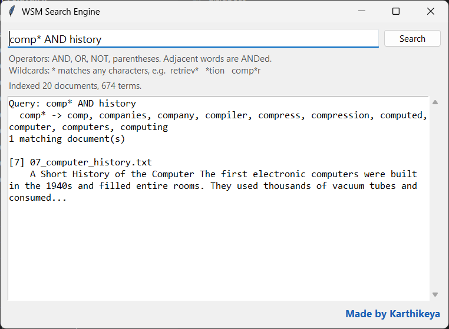
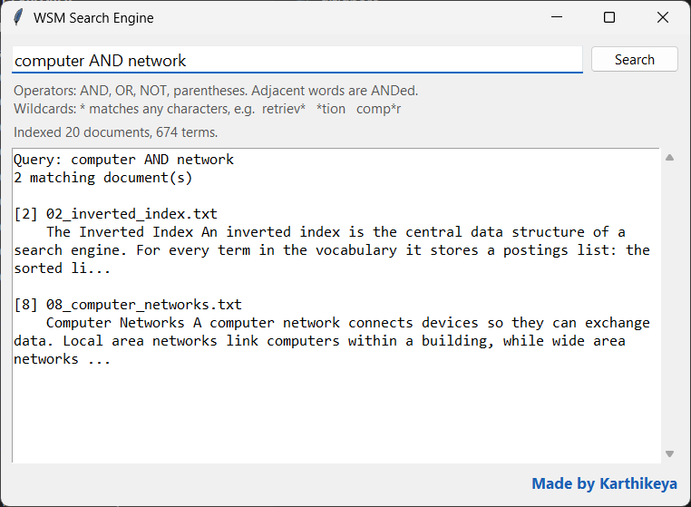
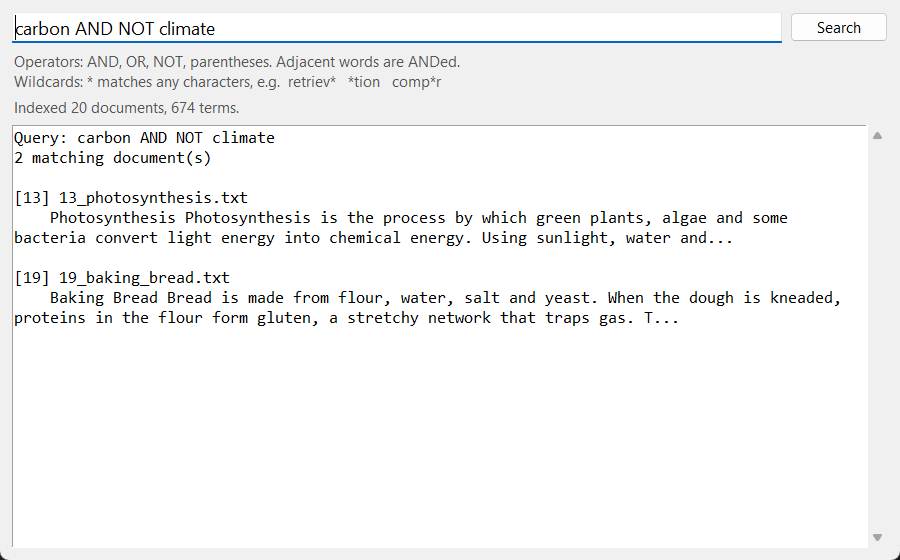
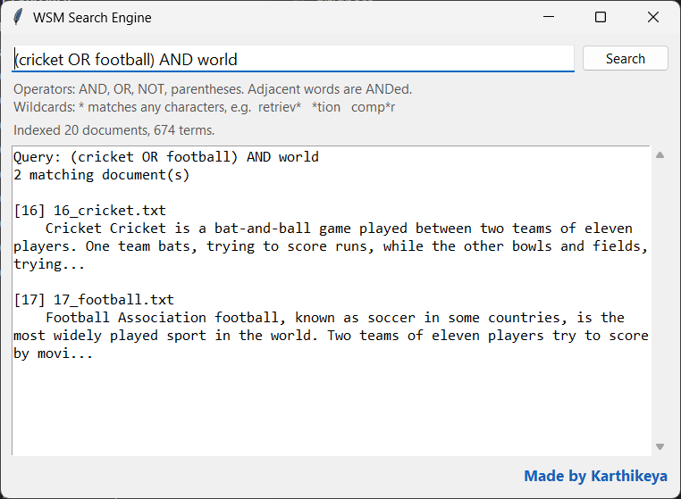
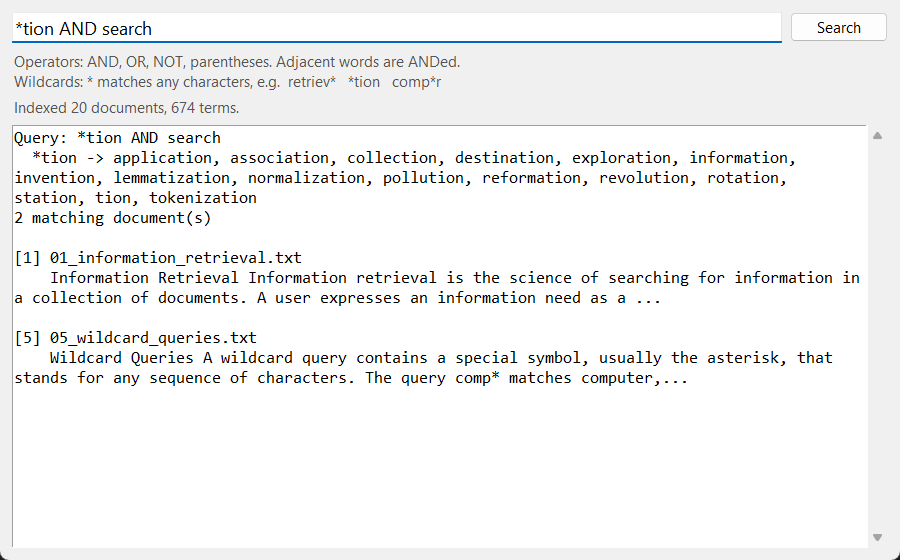
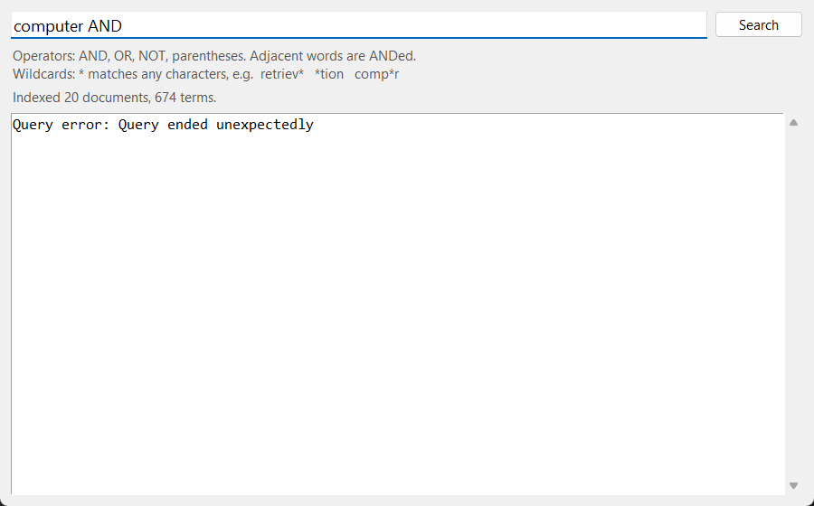

# WSM Search Engine

A Boolean search engine with wildcard queries and a Tkinter GUI. It uses only the Python standard library (Python 3.10+).



## Features

- **Boolean search** with `AND`, `OR` and `NOT`
- **Grouping** with parentheses, e.g. `(cricket OR football) AND world`
- **Implicit AND**: `index retrieval` finds documents containing both words
- **Wildcards** anywhere in a word: `comp*`, `*tion`, `re*ve`
- **Case-insensitive** matching through case folding
- **Clear error messages** for incomplete queries
- **Desktop GUI** with a search box, a Search button and a read-only result area

## Run

```
python main.py              # indexes the .txt files in ./data
python main.py path\to\docs # or any other folder
python -m unittest -v       # tests
```

## Boolean queries

Every term in the index points to a sorted list of the documents that contain it. The engine answers a query by merging those lists: `AND` keeps documents that appear in both lists, `OR` keeps documents in either list, and `NOT` removes documents that contain a word.

| Example                         | Meaning                              |
|---------------------------------|--------------------------------------|
| `index retrieval`               | both words (implicit AND)            |
| `boolean OR wildcard`           | either word                          |
| `retrieval AND NOT boolean`     | first word but not the second        |
| `(web OR boolean) AND retrieval`| grouping                             |

Precedence runs NOT, then AND, then OR. Operators can be written in any case.

| `computer AND network` | `carbon AND NOT climate` |
|:---:|:---:|
|  |  |
| Documents that contain both words | Documents about carbon that don't mention climate |

Parentheses group part of a query so it is worked out first:



## Wildcard queries

A `*` stands for any sequence of characters, anywhere in a word. Each vocabulary term is padded as `$term$` and split into bigrams (pairs of letters), so `$cat$` becomes `$c`, `ca`, `at`, `t$`. To answer a pattern, the engine intersects the term sets for the pattern's bigrams. It then checks each candidate against the full pattern to drop false positives. The matching terms are ORed together in the query, and the result area lists them so you can see how the wildcard was expanded.

| `comp* AND history` | `*tion AND search` |
|:---:|:---:|
|  |  |
| Trailing wildcard: words starting with *comp* | Leading wildcard: words ending in *tion* |

## Error handling

An incomplete query, such as an operator with nothing after it or a missing `)`, shows a readable message instead of crashing:



## Structure

```
main.py                       entry point: load -> index -> GUI
search_engine/
  document_loader.py   (1)    reads .txt files, assigns doc IDs
  tokenizer.py         (2)    splits text into word tokens
  normalizer.py        (3)    case folding, strips ' and -
  inverted_index.py    (4)    term -> sorted postings list
  query_processor.py   (5)    AND / OR / NOT / ( ) parser, postings merges
  wildcard.py          (6)    k-gram index, expands patterns like comp*
  gui.py               (7)    search box, Search button, read-only results
data/                         20 sample documents
tests/                        15 unit tests
project_screenshots/          screenshots used in this README
```
